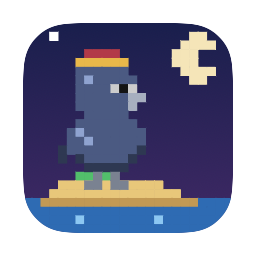
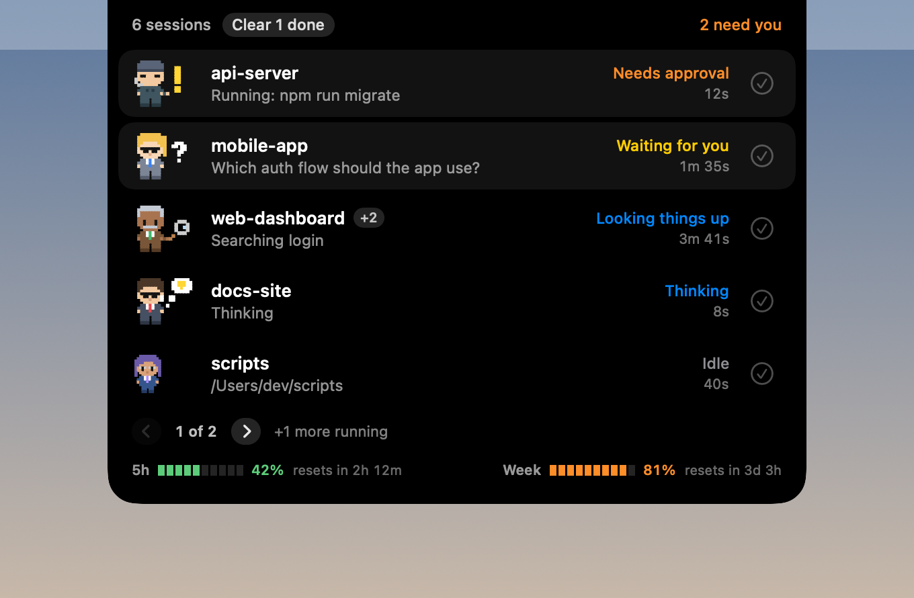
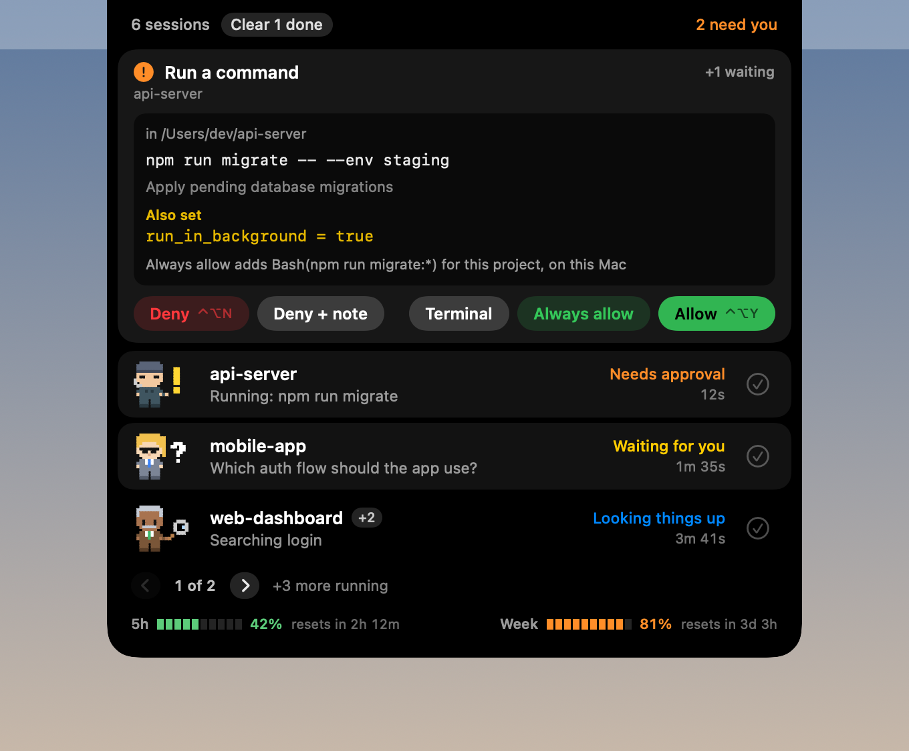
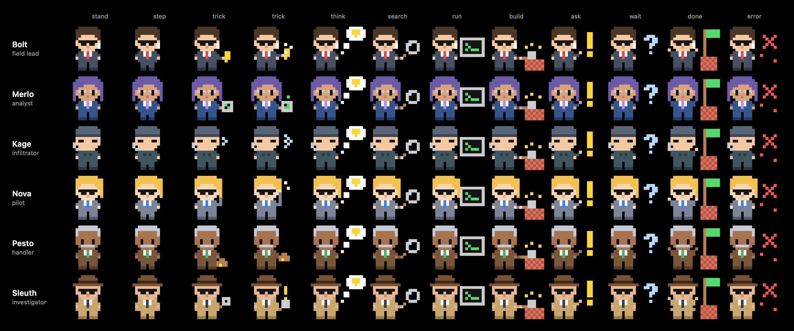
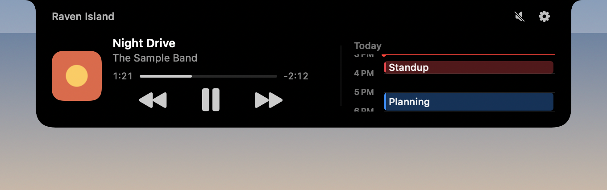

<p align="center">
  
</p>

<h1 align="center">Raven Island</h1>

<p align="center">
  A dynamic island for Claude Code in your MacBook's notch, kept by a flock of smart 8-bit ravens.<br>
  See what every agent is doing, approve what it asks for, and jump to its terminal, without leaving what you're working on.
</p>

<p align="center">
  
</p>

## Features

**Every session at a glance.** The panel sits around the notch and lists each Claude Code
session, most urgent first: project, what it's doing right now, its state, and for how long.
It opens on hover, and on its own when a session needs you. Five sessions fit on a page; the
rest are a click away, with a count of how many more are running and whether any need you.
Finished and unused sessions clear themselves after a few minutes.

**Approve from the notch.** Permission requests appear as cards. Allow, Deny, Deny with a
note to the agent, Always allow (explicit rules only), or hand it back to the terminal. Use
the buttons or ⌃⌥Y / ⌃⌥N. While a decision is waiting the panel shows just that session, and
any later decisions queue behind it ("Decision 1 of 3", with the next one named underneath),
coming up by themselves as you answer. Questions from the agent and plans to review get cards too
(preview: these two haven't been confirmed with every Claude Code version yet). Prefer to keep
approvals in the terminal? Choose **Watch only** during setup.

<p align="center">
  
</p>

**A flock of ravens.** Ravens are famously clever birds that solve puzzles and use tools, so
each session gets one of six original 8-bit ravens, and its animation tells you what the
session is up to:

| Thinking | Looking things up | Running a command | Building | Needs you | Done |
|---|---|---|---|---|---|
| thought bubble | magnifying glass | terminal prompt | hammer and bricks | "!" or "?" | flag on the wall |

Each raven has its own persona:

| Raven | Persona | Look | Party trick |
|---|---|---|---|
| Huginn | The strategist: "Thinks it through, then moves." | Top hat and monocle | A bright idea |
| Muninn | The archivist: "Never forgets a file." | Teal scarf and glasses | Reads a scroll |
| Quill | The scribe: "Writes it clean the first time." | Red beret | Writes with a quill |
| Pip | The scout: "Flies ahead to find it." | Flying cap and goggles | Takes off |
| Nyx | The night watch: "Nothing gets past the watch." | Purple hood, glowing eye | Lights a lantern |
| Tinker | The tinkerer: "Every problem is a puzzle box." | Yellow hard hat | Spins a wrench |

Huginn and Muninn are named after the two ravens of Norse myth, Thought and Memory.

When nothing is running they keep watch beside the notch. Point at one in the empty panel to
see its party trick.

<p align="center">
  
</p>

**When nothing is running.** A raven in headphones listens beside the notch while Spotify or
Apple Music plays, and the start time of your next event shows once it is within the hour. The
open panel has the track with large play, pause, and skip buttons, and the next three hours of
today as a small timeline with a line at the current time. While sessions run, the header keeps
a small player: the track name and play/pause (hidden while a decision is waiting). Calendar is off until you
switch it on in Settings, Spotify album art is off until you allow it, and nothing here ever
opens the panel by itself. With no track and no events, the ravens are back.

<p align="center">
  
</p>

**Jump to the right terminal.** Click a session to bring its terminal forward: the exact tab
in Ghostty and Terminal.app, the workspace window in VS Code and its forks, the pane in tmux
(Terminal.app and tmux are preview: written but not yet tested by hand).

**Usage limits.** The 5-hour and weekly subscription windows, with reset countdowns, at the top
left of the open panel, read from Claude Code's status line. Your existing status line keeps
working. Sound and Settings buttons sit at the top right.

**And the rest.** Optional sounds for each event (original synthesized tones, or your own pack),
quiet hours, auto-clearing of finished sessions, launch at login, a floating pill on
displays without a notch, and an uninstall that puts everything back.

## Requirements and limits

- **macOS 14 or later.** Built and used on macOS 26 with Apple silicon. The download is a
  universal app, so it also runs on Intel Macs, but that hasn't been tested yet. Macs without
  a notch (and external displays) get a small floating pill instead.
- **Claude Code only.** Other coding agents aren't supported.
- **Spotify and Apple Music only** for what's playing. Browsers and other players aren't shown.
- **Usage limits need a Pro or Max plan.** With an API key the usage strip simply stays hidden.

## Install

### Download (easiest)

1. Download the latest `RavenIsland-….zip` from [Releases](https://github.com/goodguyEJ/raven-island/releases)
   and unzip it.
2. Drag **Raven Island** into your Applications folder and open it.
3. The app isn't notarized by Apple (it's a free hobby project), so the first time macOS says
   it can't verify it. Click **Done**, then open **System Settings → Privacy & Security**,
   scroll down, and click **Open Anyway** next to Raven Island. You only do this once.
4. A setup window explains what will change and asks before touching anything. Click
   **Connect**.

Look for the bird in your menu bar. On a crowded menu bar it can end up hidden behind the
notch; quitting another menu bar app or holding ⌘ and dragging icons will bring it back.

Each zip on the Releases page comes with a SHA-256 checksum, and every release is built by
GitHub Actions from the tagged source in this repository.

### Build from source

Needs Swift 6 (`xcode-select --install` is enough; Xcode is optional).

```sh
git clone https://github.com/goodguyEJ/raven-island.git
cd raven-island
./scripts/install-app.sh
```

This builds the app, copies it to `~/Applications/Raven Island.app`, connects it to Claude
Code, and launches it. A local build is never blocked by Gatekeeper.

## What this changes on your Mac

| Where | What | Undo |
|---|---|---|
| `~/.claude/settings.json` | 14 hook entries and the status line slot (your previous status line keeps running underneath). A backup is saved beside the file first; the newest five are kept. | Settings → Integrations → Uninstall, or `scripts/uninstall.sh` |
| `~/.ravenisland/` | The helper Claude Code runs on each event, the app's socket, and a note of your previous status line | Removed by uninstall |
| App preferences | Your settings, and the last usage percentages | Removed by uninstall |
| Login items | Only if you turn on "Open at login" | Removed by uninstall |

- The helper runs on every Claude Code event and takes about 5 ms. When the app isn't
  running it exits immediately and Claude Code behaves exactly as before.
- Global shortcuts (⌃⌥Y / ⌃⌥N) exist only while an approval card is on screen, and can be
  turned off.
- The first time you click a Ghostty or Terminal session, macOS asks whether Raven Island may
  control that app. It only uses this to focus the right tab; without it, clicking just
  brings the app forward.
- The first time you press play, pause, or skip, macOS asks whether Raven Island may control
  Spotify or Music. What's playing shows without it, from the next track change.
- Turning on "Show today's events" asks for Calendar access. Raven Island only reads events.
- Uninstall resets the Calendar and Automation permissions macOS keeps for the app.
- No network connections, with one exception you switch on yourself: loading Spotify album
  art. No accounts, no analytics.

## Uninstall

In the app: **Settings → Integrations → Uninstall**, then quit and drag the app to the Bin.

Or from a clone of this repository:

```sh
./scripts/uninstall.sh
```

This removes the hooks, restores your previous status line, removes the login item, and
deletes the app, `~/.ravenisland`, and the app's preferences, and resets its Calendar and
Automation permissions. Settings backups in `~/.claude`
are left for you to delete; they are copies of your settings from before each change.

## How it works

```
Claude Code ──hook──▶ ravenisland-bridge ──unix socket──▶ Raven Island.app
     ▲                      │                            (sessions, cards, panel)
     └── decision JSON ◀────┘
```

Claude Code runs `ravenisland-bridge` on each [hook](https://docs.claude.com/en/docs/claude-code/hooks)
event. The bridge forwards the event to the app over a user-only Unix socket. For a
permission request it waits for your answer and prints the decision for Claude Code to act
on. While a card is up the app sends a heartbeat every second; if the app is closed, crashed,
or silent for 3 seconds, the bridge prints nothing and Claude Code shows its own prompt.

The full design is in [docs/SPEC.md](docs/SPEC.md); the build order in [docs/PLAN.md](docs/PLAN.md).

## Safety

Raven Island sits in the approval path of an agent that can run commands, so it is built to
fail safe:

- Requests can only be answered from the panel. The helper only talks to the real app, and
  checks every answer: allow or deny only, never a broader permission rule than the request
  offered.
- Cards show everything: every input field, the full working directory, and hidden or
  right-to-left characters as visible markers. Allow stays off until you've scrolled to the
  end, and for a moment after each card appears. Very large requests can only be denied or
  sent to the terminal.
- The panel asks macOS to keep it out of screen sharing and recordings (on by default).
- If the app hangs, quits, or crashes, Claude Code shows its own prompt within 3 seconds.
- Large tool output is never sent to the app; a hook event costs about 5 ms.
- No network connections, with one exception you switch on yourself: loading Spotify album
  art. Nothing a session says or runs, and no track or event title, is written to disk.

It went through a security review before release; findings and what is still open are in
[docs/SECURITY-REVIEW.md](docs/SECURITY-REVIEW.md). To report a problem, see
[SECURITY.md](SECURITY.md).

## Command line

The helper doubles as a small CLI:

```sh
B=~/.ravenisland/bin/ravenisland-bridge
$B status          # hook and status line installation
$B install         # (re)install hooks; --no-statusline to leave the status line alone
$B uninstall
$B sessions        # session states as JSON (no prompts or paths)
$B pending         # requests waiting for an answer (ids only)
$B jump ID-PREFIX  # bring a session's terminal forward
$B diagnostics     # troubleshooting report (no prompts, commands, or paths)
```

## Development

```sh
./scripts/dev.sh           # rebuild, restart, launch
./scripts/test.sh          # unit tests (Swift Testing)
python3 scripts/e2e.py     # end-to-end tests against an isolated debug instance
./scripts/build-app.sh     # build "build/Raven Island.app"
```

`Raven Island --snapshot DIR` renders every panel state and the character sheet to PNGs, and
`--export-sounds DIR` writes the built-in sounds as a starting point for a custom pack.

| Path | What |
|---|---|
| `Sources/RavenIslandCore` | Wire format, socket framing, session state, requests, installer, characters (no AppKit) |
| `Sources/ravenisland-bridge` | Hook command and CLI |
| `Sources/RavenIslandApp` | Menu bar app, notch panel, cards, settings |
| `Tests/RavenIslandCoreTests` | Unit tests |
| `scripts/` | Build, install, uninstall, test scripts |

See [CONTRIBUTING.md](CONTRIBUTING.md) before opening a pull request.

## License

[MIT](LICENSE). The pixel art and sounds are original to this project.

Raven Island is an independent project and is not affiliated with or endorsed by Anthropic.
"Claude" and "Claude Code" are trademarks of Anthropic.
